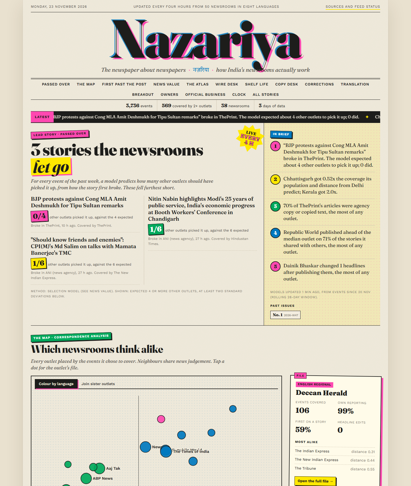
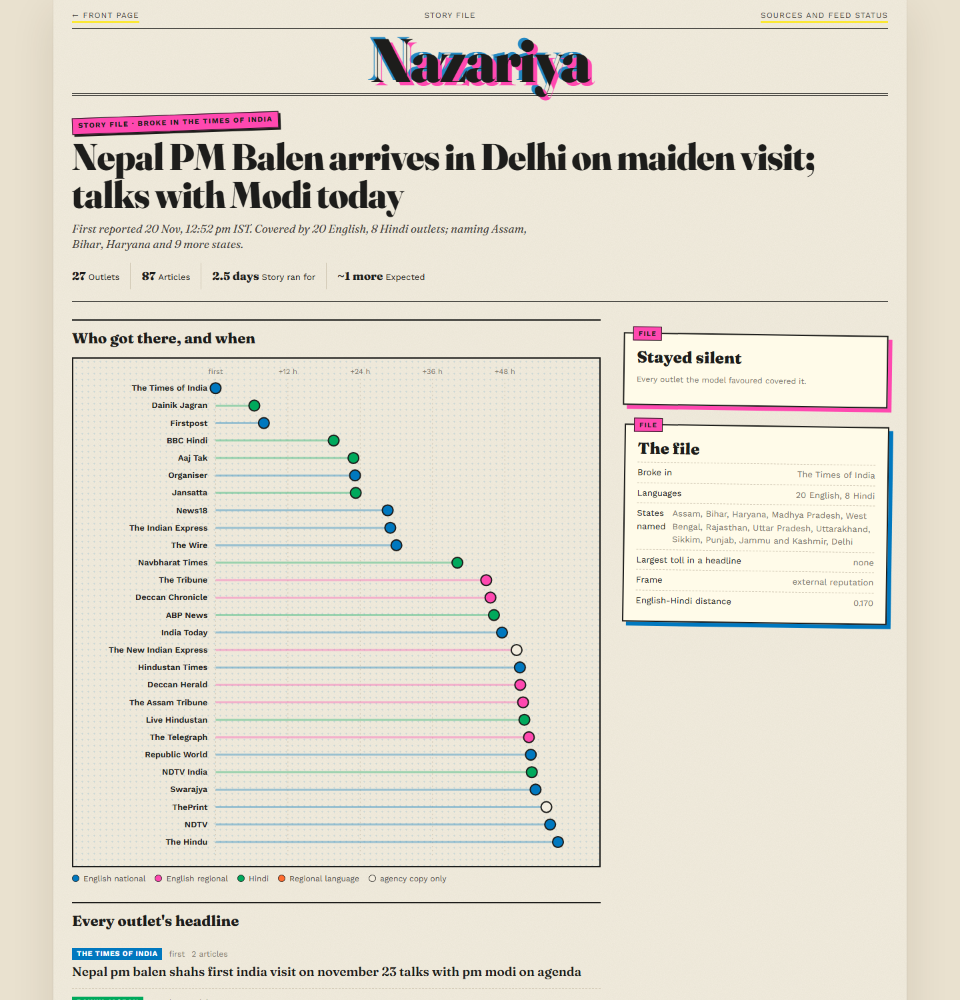

# Nazariya: How India's Newsrooms Actually Work

When fifty Indian newsrooms cover the same day of news, who gets there first, who copies whom, which stories and which states get passed over, how long a story stays alive, and do outlets with the same owner cover the same things? Nazariya answers that from the news itself. Every four hours it reads the feeds of 50 outlets in eight languages (English, Hindi, Tamil, Bengali, Marathi, Malayalam, Telugu and Kannada) plus the government's press releases, extracts each article's text, removes duplicates and detects agency copy, and matches articles about the same event across languages with multilingual embeddings. Each event is then condensed into a small, permanent record (who covered it, when, with what kind of copy, naming which people and states), and a set of models is fitted on those records: a selection model of what makes a story news, a coverage model per state, survival curves for how long stories last, a map of which newsrooms think alike, lead-lag timing, and a permutation test of whether shared ownership shows up in coverage.

Built with Python (trafilatura, sentence-transformers with BGE-M3, scikit-learn, SciPy, SQLAlchemy on SQLite) and a static vanilla JS front page, rebuilt by GitHub Actions every four hours from public outlet feeds, PIB press releases, Wikidata, Wikipedia and the Census of India.

> **What it's for:** reading the news about the news. Open the front page to see which stories the newsrooms let go this week, then follow any story to see who broke it, who followed and when, every outlet's headline side by side, and who stayed silent; or open any outlet's file to see where it sits among its peers, when it publishes, what it skips and who owns it.

**Live demo:** [halcyonvector.github.io/Nazariya](https://halcyonvector.github.io/Nazariya/)





---

## Disclaimer

Nazariya measures **coverage patterns, not truth, quality or intent.** An outlet "skipping" a story means its feeds did not carry it while they were being read, not that it was suppressed; a high share of agency copy is a business choice, not a failing. Every model is fitted on a rolling window of recent events, so numbers move from week to week, and several (see Honest Limitations) are still settling on the first weeks of data. Accuracy figures for clustering and entity linking are measured against LLM-generated labels and are provisional until a human-labelled set replaces them. Ownership comes from each outlet's Wikipedia article and is cited on its page; check the source before relying on it. Article text is processed only to compute these measures: it is never published, and it is deleted after three days.

---

## Findings

Real results from the first three days of data (20 to 22 November 2026: 3,736 events, 569 of them covered by two or more outlets, from the 38 English and Hindi outlets; the regional-language outlets joined on 23 November). Every figure here is provisional and will move as the 28-day window fills.

- **Agency copy travels; a story that breaks in Hindi mostly does not reach English desks.** In the selection model, a first report that is agency copy multiplies the odds that another outlet covers the event by **2.3** for English national outlets (95% interval 1.3 to 3.4), **5.2** for English regional ones and **3.8** for Hindi ones, and naming an Indian politician roughly doubles them in every group. A story that broke in Hindi has **0.29 times** the odds of being picked up by an English national outlet (0.20 to 0.33). The models separate covered from uncovered pairs with held-out AUC between 0.76 and 0.85.
- **Size and distance explain most of the coverage a state gets, and some states still fall short.** Population and distance from Delhi explain **87.5%** of the deviance in how much coverage names each state: coverage rises about 0.4% for every 1% more people and falls about 0.5% for every 1% further from Delhi. Even after that, **Chhattisgarh got 0.52 times** and Odisha 0.61 times the coverage the model expects, while **Kerala got 2.0 times**.
- **Sister outlets cover the same stories, but not all of them.** Across the 9 pairs of outlets with a shared owner, coverage overlaps more than for different-owner outlets in the same languages (permutation test, **p = 0.007**). The effect is concentrated: **Aaj Tak and India Today share 37% of their stories against a 10% baseline**, and Firstpost and News18 26% against 15%, while ABP News and The Telegraph overlap no more than any two unrelated outlets. Shared newsrooms and content sharing are the likely mechanism; the data shows the overlap, not its cause.
- **One outlet runs mostly agency copy.** Of ThePrint's 249 articles whose text could be read, **70%** were credited agency copy or near-duplicates of another outlet's text. The next highest was The Tribune at 26%; 19 of the 23 outlets measured were under 5%.
- **Some newsrooms are reliably first.** On stories several outlets covered, **Republic World** published its own report before the median outlet on **71%** of 72 shared stories and The Times of India on 70% of 97, while The Hindu did so on 7%.
- **Headlines change after publication, sometimes in substance.** Among the first edits logged, Dainik Bhaskar changed a Taj Mahal headline from CISF jawans being *accused of assaulting a tourist* to a *scuffle between CISF jawans and tourists*, and the Hindustan Times changed "after suspected drone attack" to "after suspected Ukrainian drone attack".
- **A third of some outlets' stories go out at night.** Greater Kashmir, Deccan Chronicle and The Wire each publish about **37%** of their stories between 10 pm and 6 am IST.

Real problems found while building it, and what changed:

- **The hosted database ran out of compute twice.** A hosted Postgres plan's monthly compute allowance was exhausted in about three and a half days of hourly runs, and again by mid-month at one run every four hours. The database is now a SQLite file that each run downloads and uploads as an encrypted release asset, and a failed run leaves the last good state untouched (as it did when a GitHub-side error killed one run mid-way).
- **Agency bylines were invisible to the extractor.** Only 9 of 150 extracted Hindustan Times articles even mentioned PTI, ANI or IANS: bylines live in page metadata, which text extraction drops. Bylines are now read from the metadata too, and agency shares are computed only over articles whose text could be read.
- **One feed held only 1.6 hours of news.** Amar Ujala publishes about 440 stories an hour and its news sitemap keeps the latest 700, so runs four hours apart missed most of it. Its category feeds (18 to 90 hours each) are now read on every run as well.
- **"New Delhi:" is a dateline, not a place.** Counting it inflated Delhi's coverage 17-fold against its population in a first pass; a lone Delhi mention in an article that opens with the dateline no longer counts.
- **The selection model was first trained on its own outcome.** Event features summed over all coverage (any agency byline, any politician named) partly result from wide coverage. Features now come from the first report alone.
- **Clustering sometimes merges similar stories.** One "9 killed in Kota" event absorbed other road accidents and named 13 states. Story pages now show the first few states and label the toll as the largest in any headline.
- **Sitemaps that list only the latest items fake a publishing rhythm.** A one-off read made two Hindi dailies look as if they published only at night. The newsroom clock now leaves out any outlet whose timestamps do not yet span most of the day.

---

## Features

### Passed Over and News Value

- **Stories the newsrooms let go:** for every event of the past week, the selection model predicts how many other outlets should have covered it, given how it looked when it first broke. Events furthest below that prediction (expected 4 or more, at least two standard deviations short) lead the front page.
- **What makes a story news:** a logistic regression per outlet group (English national, English regional, Hindi, regional language) on first-report features: a reported death toll, a named politician, agency copy, a government release, a New Delhi dateline, the states named, the language it broke in and its frame. Outlet fixed effects absorb sheer volume; odds ratios carry 95% bootstrap intervals and the fit is checked with five-fold validation split by event.
- **Features are taken from the first report only**, not from all coverage, because totals over every article are partly a result of wide coverage (a story many outlets ran is more likely to contain an agency byline somewhere).

### The Map and First Past the Post

- **Which newsrooms think alike:** correspondence analysis of the outlet-by-event matrix places every outlet by the events it chose to cover. Rings show how far an outlet moves when the events are resampled (40 bootstrap resamples, rotated back onto the full map), and the stories at each end of each axis say what the axes mean.
- **Who gets there first:** on events several outlets covered, each outlet's first own (non-agency, properly dated) report is timed against the others. Pairwise median leads fill a head-to-head table; the ranking is the share of events where an outlet beat the median outlet, with Wilson intervals. Feeds that give dates without times are left out.

### The Atlas

- **Coverage each state should get, and gets:** a Poisson regression of how much coverage names each state, on its 2011 population and its distance from Delhi. Tiles show actual divided by expected, so a state is flagged only when it is ignored beyond what size and distance explain. The Northeast is deliberately not a model term, so that any extra neglect shows up in the residuals.
- **Dateline-aware:** a single "New Delhi:" at the start of an article is the dateline, not the story's place, and does not count as a Delhi mention.

### Shelf Life

- **How long a story stays in the news:** Kaplan-Meier survival curves of how long events keep drawing new articles, split by where the story is, the language it broke in, its size and its frame, with log-rank tests against the rest. Stories still running count as censored, not ended.

### Wire Desk and Copy Desk

- **Own reporting or agency copy:** agency bylines are read from the article's dateline line and from the page's byline metadata, and near-duplicate text is caught with 64-bit SimHash. Shares are counted only over articles whose text could be read.
- **Who copies whom:** text that near-duplicates an earlier article from a different outlet with no agency credit, drawn as source-to-copier pairs.

### Corrections and Translation

- **Headlines changed after publishing:** whenever an outlet's own feed shows a story it showed before under a different headline, both versions are kept and shown as a word-level diff. Changes in spacing, case or quote marks are ignored.
- **Stories that disappeared:** a sample of articles is checked again one to three days after publishing; one counts as removed only when it is clearly gone (HTTP 404 or 410, or sent to the front page) on two checks at least four hours apart. Blocks, rate limits and failed requests never count.
- **Lost in translation:** for events both English and Hindi outlets covered, the distance between the two languages' coverage in the multilingual embedding space, ranked.

### Official Business and the Newsroom Clock

- **Government announcements nobody ran:** every PIB press release is kept with the event it landed in and its issuing ministry (read from the release's opening line, mapped from Hindi to English names). After two days a release counts as reported if any tracked outlet covered that event; the page ranks ministries by the share reported.
- **When each newsroom publishes:** a heatmap of each outlet's stories by hour of the day (IST), sorted by its share between 10 pm and 6 am. Feeds that have only ever shown part of the day are left out until they cover most of it.

### Breakout Watch

- **Which of today's stories will spread:** from a story's first two hours (how many outlets and languages carry it, and how it broke: agency copy, a government release, a death toll, a politician, a Delhi dateline, the Northeast, its language and hour), a logistic model estimates the chance it reaches ten or more newsrooms.
- **A published record:** the model is fitted on the older 70% of finished stories and scored on the newer 30%, so its AUC, hit rate among its top picks and calibration (predicted against observed) are what it would have achieved looking forward.

### Who Gets Named

- **Who each newsroom puts in its headlines:** for the most-named people and parties, how often an outlet's headlines name them against the other outlets' headlines on the same stories. Headlines, not article text, because every headline is readable while text is cut short for some outlets. Each cell is an exact binomial test against the peers' rate, with the false-discovery rate held at 5% across all cells, and needs at least five expected mentions. Outlets whose feeds give headlines rebuilt from web addresses (where "BJP" reads as "bjp") are left out.

### Language Bridges and Agenda Fingerprints

- **How stories cross languages:** for stories three or more outlets covered, the share that broke in one language (English, Hindi or a regional language) and were carried in another, how long that took, and which outlets were first to carry a story across.
- **What each newsroom spends its coverage on:** each outlet's share of stories in each frame (crime, health, politics, the economy and so on) against the share across all outlets, with 95% intervals.

### Who Owns the News

- **Ownership as cited data:** each outlet's owner is taken from its English Wikipedia infobox and stored with the article as its source.
- **Do sister outlets cover the same stories?** Coverage overlap (Jaccard index) of each pair of outlets with a shared owner, against different-owner pairs in the same language combination, with a permutation test that shuffles owners within each language. The outlet map can draw lines between sister outlets.

### Story Files, Outlet Files and Weekly Editions

- **Story files:** one page per event three or more outlets covered: a timeline of who published when, every outlet's headline linked to its article, agency copy and headline edits marked, and the outlets the model expected that stayed silent.
- **Outlet files:** one page per outlet: its position among its peers with a weekly trail, its publishing clock, the states it covers more and less than its peers, what it spends its coverage on, who it puts in its headlines, the big stories it skipped, the stories it broke, copying in both directions, its headline edits, and its owner with sister outlets.
- **Weekly editions:** the first run each Monday freezes the front page as that week's numbered issue, readable for good from "Past issues" and followable through an [RSS feed](https://halcyonvector.github.io/Nazariya/data/feed.xml).
- **Search:** every story three or more newsrooms covered, searchable by headline.

### UI: A Newspaper About Newspapers

- **A risograph-printed broadsheet:** a nameplate with an off-register print effect, a twelve-column grid with column rules, four fluorescent inks on cream paper, halftone panels and a scrolling findings ticker. Each section's headline is written from its own numbers.
- **Honest empty states:** a section without enough data says so, and why, inside its own story.
- **Works on a phone:** every page stacks to one column without sideways scrolling, and motion stops when the system asks for reduced motion.

---

## Data Source

| Source | What it provides | Access |
| --- | --- | --- |
| 50 outlet feeds: news sitemaps and RSS ([list and live status](https://halcyonvector.github.io/Nazariya/health.html)) | Headlines, links, publish times; article text for extraction | Public feeds, robots.txt obeyed |
| [Press Information Bureau](https://pib.gov.in) | Government press releases and the issuing ministry | Public RSS |
| [ANI](https://www.aninews.in/) | Wire stories, as a reference for agency copy | Public sitemap |
| [Wikidata](https://www.wikidata.org) | People, parties and states, with state names in eight languages | Public API |
| [Wikipedia](https://en.wikipedia.org) | Who owns each outlet ([config/owners.yaml](config/owners.yaml)) | Public API |
| [Census of India 2011](https://censusindia.gov.in) | State populations ([config/states.yaml](config/states.yaml)) | Published tables |

**The outlets:** 17 English national outlets, 9 English regional ones (the English papers of particular states), 12 Hindi outlets and 12 in six regional languages (two each in Tamil, Bengali, Marathi, Malayalam, Telugu and Kannada). Each outlet has a chain of sources tried in order, ending in Google News headlines as a last resort; fast-publishing outlets whose main feed holds less than four hours of items also have category feeds read on every run. No outlet carries an editorial-leaning label anywhere in the configuration: groupings come from the data.

**Cleaning and joining:**

1. **Discover:** each outlet's sources are read; items older than three days or outside the outlet's own domain are dropped; URLs are canonicalised.
2. **Extract:** trafilatura pulls article text (newest first, a capped number per outlet per run); SimHash marks re-published duplicates and cross-outlet copies; agency bylines are read from the text and the page metadata.
3. **Link entities:** a dictionary linker over a Wikidata alias table finds people, parties and states in English, Hindi and (for states) six more languages, including inflected forms.
4. **Embed and cluster:** the headline plus the first ~200 words are embedded with BGE-M3; each article joins the nearest open event above a cosine threshold of 0.65, or starts a new one; events close after 72 hours without a new article. An article that names states, none of which the event names, joins only if it is nearly a duplicate (0.80), so look-alike stories in different states (road accidents, weather) stay apart.
5. **Condense:** every recently active event becomes one `event_facts` row plus one `coverage` row per outlet; these are what the models read and they are never deleted.

---

## Tech Stack

| Layer | Technology |
| --- | --- |
| Ingestion | httpx, feedparser, lxml, trafilatura |
| Dedup and copy detection | 64-bit SimHash, agency byline rules |
| Embeddings and clustering | sentence-transformers (BGE-M3), online centroid clustering |
| Entity linking | Wikidata alias table, custom dictionary linker |
| Models | scikit-learn (logistic and Poisson regression), SciPy (correspondence analysis, Procrustes, hierarchical clustering), NumPy (Kaplan-Meier, log-rank, permutation tests) |
| Storage | SQLite via SQLAlchemy, kept between runs as an encrypted GitHub release asset |
| Scheduling | GitHub Actions every four hours, plus a Windows scheduled task for five outlets that block datacenter IPs |
| Front end | Static HTML, CSS and vanilla JS on GitHub Pages; Fraunces, Work Sans and Tiro Devanagari Hindi |
| Testing | pytest |

---

## Prerequisites

- Python 3.11 or newer
- About 3 GB of disk for the BGE-M3 model (downloaded on first use); a GPU makes embedding much faster but is not needed
- To run the scheduled pipeline yourself: the GitHub CLI (`gh`), OpenSSL, and a `STATE_KEY` repository secret

---

## Quick Start

```bash
git clone https://github.com/HalcyonVector/Nazariya.git
cd Nazariya
python -m venv .venv
.venv/Scripts/pip install -e ".[ml,dev]"      # Windows; use .venv/bin/pip on Linux or macOS
```

Run the pipeline once against a local SQLite file (`data/nazariya.db` when `DATABASE_URL` is unset):

```bash
python -m nazariya.ingest            # read every outlet's feeds and extract text
python -m nazariya.cluster           # embed new articles and group them into events
python -m nazariya.entities.run      # link people, parties and states
python -m nazariya.framing.infer     # predict each article's frame
python -m nazariya.facts             # condense events into the long-lived fact tables
python -m nazariya.analytics.run     # fit every model; writes site/data/
python -m nazariya.export            # source health for the Sources page
```

Then serve the site:

```bash
python -m http.server 8765 --directory site
```

and open http://localhost:8765.

### Tests

```bash
pytest -q
```

### Maintenance

```bash
python -m nazariya.probe --only <outlet_id>   # check a new outlet's feeds -> reports/feed_probe.md
python -m nazariya.health                     # per-outlet feed health -> reports/health.md
python -m nazariya.retain --dry-run           # what retention would delete
python -m nazariya.entities.regional          # refresh state names in the regional languages
```

---

## Project Structure

```
Nazariya/
├── .github/workflows/ingest.yml   # the four-hourly pipeline and the Pages deploy
├── config/
│   ├── outlets.yaml               # the 50 outlets (+ PIB and ANI as references)
│   ├── feeds.yaml                 # each outlet's source chain and supplementary feeds
│   ├── owners.yaml                # owner of each outlet, with its Wikipedia source
│   ├── states.yaml                # Census 2011 populations, coordinates, tile positions
│   ├── ministries.yaml            # PIB issuing bodies, Hindi to English
│   └── entities/                  # Wikidata alias table, regional state names, linker rules
├── nazariya/
│   ├── ingest.py                  # discover, extract, dedup, headline-edit tracking
│   ├── cluster.py                 # BGE-M3 embedding and online event clustering
│   ├── entities/                  # alias-table build and the dictionary linker
│   ├── framing/                   # frame classifier trained on LLM silver labels
│   ├── facts.py                   # long-lived event_facts, coverage, copies, releases
│   ├── analytics/                 # every model, story and outlet pages, weekly editions
│   ├── inbox.py                   # hand-off of home-PC articles to the cloud run
│   ├── retain.py                  # retention: raw rows 8 days, text 3 days
│   └── db.py                      # schema and column migrations
├── scripts/
│   ├── state.sh                   # encrypted pull and push of the SQLite state
│   └── home_ingest.ps1            # the home-PC task for outlets that block datacenter IPs
├── site/                          # front page, story and outlet pages, sources page
├── labels/                        # event-pair and framing labels (LLM silver, some human)
├── reports/                       # embedding, clustering and entity-linking evaluations
└── tests/
```

---

## Architecture

```
GitHub Actions, every 4 hours
  pull encrypted state (release asset) ─► import home-PC inbox
  ─► ingest (50 outlets + PIB + ANI) ─► embed + cluster (BGE-M3, CPU)
  ─► link entities ─► predict frames ─► condense into fact tables
  ─► fit models, write story pages, outlet files, weekly edition
  ─► retention ─► integrity check ─► push encrypted state ─► deploy GitHub Pages

Home PC, every 4 hours (5 outlets that block datacenter IPs)
  ingest into its own SQLite ─► embed on the GPU ─► push an encrypted inbox asset
```

- **No database server.** The pipeline's database is one SQLite file. Each run downloads it from the repository's `state` release, works on it locally and uploads it again, after an integrity check, with a rotating backup for each weekday. A hosted Postgres was tried first; its monthly compute allowance ran out twice under a four-hourly pipeline, so it was removed.
- **Encrypted at rest.** Release assets of a public repository are public, and the file holds a few days of article text, so it is encrypted with AES-256 (OpenSSL, PBKDF2) using the `STATE_KEY` secret.
- **Small permanent facts, short-lived raw data.** Articles are kept for 8 days and their text for 3; vectors are dropped once used. The fact tables the models read take on the order of 10 MB a month, so months of history fit comfortably.
- **Bounded work per run.** Extraction is capped per outlet and embedding per run (newest first); any backlog carries over to the next run.
- **One writer.** Only the cloud run writes the main state; the home PC hands over its articles through its own encrypted inbox file.
- **New columns migrate themselves:** columns added to the schema later are added to the stored file on start.
- **Runs that GitHub drops are restarted.** Scheduled runs are sometimes delayed or skipped when GitHub is busy, so an hourly watchdog starts the pipeline whenever more than 4.5 hours have passed since the last one.
- **Design changes publish in a minute.** A push that changes only the site lays the new pages over the latest pipeline data and deploys, without waiting for the next run.

---

## Testing and Validation

```bash
pytest -q
```

**Unit and integration tests (55):** fact condensation on a seeded event (first report, dateline-only Delhi mentions dropped, English-Hindi drift, agency copy, cross-outlet copies), the home-inbox round trip, schema migration, death-toll parsing in English and Hindi, headline-edit detection (slug titles and cosmetic changes ignored), ministry names, Kaplan-Meier and log-rank, correspondence analysis, Procrustes alignment of weekly positions, weekly editions freezing once per Monday, the ownership permutation test and the breakout forecast on planted data, the state rule in clustering, headline edits that differ only in punctuation or come from another feed, removal detection (blocks are never removals), regional state names with case endings, Marathi language detection, agency bylines from metadata, retention and the clustering primitives.

**Evaluations (provisional: scored against LLM silver labels, a few human):**

- **Embeddings** ([reports/embedding_bakeoff.md](reports/embedding_bakeoff.md)): on 399 labelled article pairs, BGE-M3 separates same-event pairs with ROC-AUC **0.982** (95% CI 0.97 to 0.99), and **0.979** on English-Hindi pairs, ahead of multilingual E5 and MPNet.
- **Clustering** ([reports/clustering_eval.md](reports/clustering_eval.md)): replaying the online algorithm over 20,490 articles, pairwise precision **0.872** and recall **0.841** at the threshold in use.
- **Entity linking** ([reports/entities_eval.md](reports/entities_eval.md)): link precision **0.837** across 150 articles (0.848 English, 0.815 Hindi), as judged by a local LLM.

---

## Honest Limitations

- **The models are young.** History starts on 20 November 2026; most sections are meaningful after about two weeks and reach a full 28-day window around 18 December. Shelf life, release pickup and headline edits need stories old enough to judge and say "collecting data" until then.
- **Clustering sometimes merges separate stories.** At the chosen threshold about one in eight same-event calls is wrong; a large merged event (several road accidents in different states, for example) inflates its outlet count and the states it names. Story pages show the first few states and the "largest toll in a headline" rather than claiming one.
- **Feeds are a sample.** An outlet "skipping" a story means its feeds did not carry it. Amar Ujala's news sitemap holds about 1.6 hours of a very large output, so its local city stories are only partly captured even with its category feeds; national stories are covered.
- **Agency copy is under-counted** where outlets credit agencies only in places the extractor does not see.
- **"Who gets named" reads headlines only.** It measures what an outlet chose to put in its headlines, which is the most visible choice but not the whole article; the Times of India is left out because its feed gives headlines rebuilt from web addresses.
- **Entity coverage is uneven.** People and parties are linked in English and Hindi only; regional-language outlets are linked for states, with inflected forms matched by stem, which misses some forms.
- **Provisional accuracy figures.** Clustering, linking and the frame classifier are evaluated against LLM silver labels; one human labelling session at the end is planned to replace them.
- **Ownership is as Wikipedia states it**, read on 23 November 2026, and ownership changes. One outlet has no owner listed, and the overlap between sister outlets can come from shared newsrooms or content sharing; the data shows the overlap, not its cause.
- **Five outlets depend on a home PC** because they block datacenter IPs; when that machine is off, they show as "no data", never as "did not cover".

---

## Suggested Future Features

- **A human-labelled gold set** to replace the silver labels behind the clustering, linking and framing figures.
- **People and parties in regional languages**, not just states.
- **Story arcs:** link events about the same named case across weeks, to follow a story from first report to verdict.
- **A feed of weekly editions** so each new issue can be followed.

---

## Author

**Sagnik**

GitHub: [@HalcyonVector](https://github.com/HalcyonVector)

---

## License

MIT License. See [LICENSE](./LICENSE). Free to use, modify, and distribute, with no warranty.
